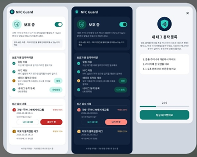

# NFC Guard

**AI와 규칙 기반 탐지로 의도하지 않은 NFC 동작을 감지하고, NFC 동작 제한과 사용 이력을 제공하는 Android 프로젝트입니다.**

> 이 문서는 **2026-11-11 회의에서 확정한 기획**과 **현재 코드의 구현 상태**를 구분합니다.
> NFC 동작 제한과 위치 로그는 이번 개발 목표이며, 현재 구현 완료 기능으로 표시하지 않습니다.

**개발 기준:** [`feature/unintended-tap-detection`](https://github.com/warden-sc/nfc-guard-/tree/feature/unintended-tap-detection) · [작업 PR #2](https://github.com/warden-sc/nfc-guard-/pull/2)

`main`은 아직 이 작업 PR을 병합하지 않은 상태입니다. 최신 코드와 설명은 개발 브랜치에서 확인합니다.

## 우리가 만드는 것

이번 개발은 아래 **네 가지**에 집중합니다. 기능은 실기기 테스트와 사용자 피드백을 바탕으로 점진적으로 업데이트합니다.

| 확정 범위 | 개발 방향 |
|---|---|
| **AI + 규칙 기반 탐지** | 테스트 휴대폰에서 자연스러운 태깅·결제 행동의 센서값을 수집합니다. 초기에는 규칙과 모델을 함께 사용하고, 실측 결과로 개선합니다. |
| **NFC 동작 제한** | 의도하지 않은 상황에서 NFC가 동작·응답하지 못하도록 소프트웨어적으로 제한하는 것이 목표입니다. 금융 거래의 승인·취소를 직접 제어하는 기능은 아닙니다. |
| **불편을 줄이는 UI/UX** | 탐지 오류로 정상 사용이 방해되면 사용자가 상태를 이해하고 제한을 해제하거나 재시도할 수 있도록 모바일 담당자가 화면·흐름을 보완합니다. |
| **시각·위치가 있는 로그** | 언제, 어느 위치에서 NFC 이벤트와 제한·해제 동작이 있었는지 확인할 수 있도록 합니다. 위치 정확도와 측정 시각도 함께 다룹니다. |

카드사/FDS 연동, 결제 승인·취소, iOS 기능 확장은 이번 개발 범위에 넣지 않습니다.

## 화면



팀에서 공유한 기존 UI 참고 이미지입니다. 메인 화면의 라이트·다크 테마, 최근 기록, 태깅 동작 등록 구성을 보여줍니다.

이미지의 위험도 숫자와 “보호 중” 표시는 과거 시안이며, 검증된 공격 확률이나 NFC 제한 구현 완료를 뜻하지 않습니다. 위치 표시와 제한·해제 UX는 추가 반영 대상입니다.

## 현재 어디까지 되어 있나

| 영역 | 코드에서 확인한 상태 | 다음 작업 |
|---|---|---|
| 탐지 | 센서 수집, 움직임·근접·조도 기반 규칙, TFLite 모델을 결합하는 경로가 있습니다. | 실제 데이터를 모으고 탐지 결과·오탐을 평가합니다. 학습된 모델이 없으면 현재 규칙으로 동작합니다. |
| NFC 동작 제한 | 현재 서비스는 APDU 응답을 즉시 반환하고 사후 알림·기록을 수행합니다. NFC를 제한하는 구현은 아직 없습니다. | 사용할 제어 경로·권한과 기기별 실제 제한·복구 동작을 검증하고 구현합니다. |
| UI/UX | 메인·온보딩·알림 응답·최근 기록 화면이 있습니다. | 제한 상태를 명확히 표시하고 정상 사용을 빠르게 복구하는 흐름을 보완합니다. |
| 위치 로그 | 시각·이유·점수·사용자 응답을 저장하는 로그가 있습니다. 위치 필드·권한·수집은 아직 없습니다. | 위치와 정확도·측정 시각을 기록하고, 못 구한 위치를 명확히 표시합니다. |
| 서버·모델 연결 | 기기 인증, 이벤트·라벨 수집, 데이터 export, 서명된 모델 배포 코드가 있습니다. | 실기기 수집부터 앱의 모델 적용까지 연결해서 확인합니다. |

**현재 앱의 스위치는 탐지·센서 수집 활성화 설정입니다. NFC 하드웨어를 켜고 끄거나 NFC 제한을 해제하는 기능으로 해석하지 않습니다.**

## 동작 흐름

개발 목표:

```text
자연스러운 태깅 행동 측정
  -> AI + 규칙 기반 판단
  -> 필요한 NFC 동작 제한과 사용자 안내
  -> 사용자의 해제·재시도
  -> 시각·위치·상태 이력 확인
  -> 실측 데이터와 피드백으로 업데이트
```

현재 코드:

```text
센서 버퍼 + 근접·조도·화면 상태
  -> 관찰 가능한 NFC 이벤트
  -> 규칙 + 사용 가능한 모델
  -> 알림·진동 + 로컬/서버 기록
  -> 사용자 응답 수집
```

NFC 이벤트를 받는 범위와 NFC 동작을 제한하는 범위는 별도 검증 항목입니다.

자체 데모 AID의 HCE 통신이 된다고 다른 지갑·교통카드 통신도 모두 관찰하거나 제어되는 것은 아닙니다.

## 데이터와 모델

- 지정된 모션을 강요하기보다, 실험용 휴대폰으로 자연스러운 태깅 행동을 측정합니다.
- 대표 조건부터 수집합니다: 앞·뒤 주머니, 가방 적재, 이동·정지, 리더 높이·접근 방향, 태그 재시도 등.
- 의도적 태깅과 비의도 접촉 모사를 구분하고, 실제 결제·모사 통신·사용자 응답의 출처를 남깁니다.
- 전이학습은 기존 코드의 후보 경로입니다. 필요한 데이터·백본·전처리를 확인한 뒤 기존 규칙 및 다른 모델과 비교합니다.
- 센서 패턴이 다르다는 사실이나 사용자 응답을 곧바로 “실제 공격 확정”으로 해석하지 않습니다.

자세한 합의와 위치 정확도 기준은 [확정 범위 및 개발 기준](docs/PROJECT_SCOPE.md)을 봅니다.

## 파일 구조와 문서

```text
android/        Android 앱: 센서, 탐지, 화면, 이벤트 기록
server-java/    서버: 기기 인증, 이벤트·라벨, 학습 데이터, 모델 배포
ml-python/      모델 실험: 전처리, 사전학습·파인튜닝, TFLite 산출물
docs/           범위·아키텍처·설정·화면 참고 자료
ios/            기존 축소판 코드, 이번 Android 개발 범위 밖
```

| 문서 | 읽는 목적 |
|---|---|
| [확정 범위 및 개발 기준](docs/PROJECT_SCOPE.md) | 네 가지 목표, 현재 구현과의 차이, 데이터·위치·UX 기준 |
| [현재 아키텍처](docs/ARCHITECTURE.md) | 현재 코드의 판정 흐름, 데이터 계약, 모델 연결, 감지 경로의 한계 |
| [개발 환경과 실행](docs/SETUP.md) | Android Studio·서버 설정, 실기기 NFC 테스트, ML 실행 |
| [이전 KPI·R&R 제안](docs/KPI_RnR_수정_의사결정안.md) | 과거 제안 기록. 이번 확정 범위와 다르면 이번 문서를 우선 |

## 개발 순서

1. 실기기에서 NFC 이벤트 수신, NFC 제한·복구 가능 범위를 먼저 확인합니다.
2. 대표 행동 데이터를 수집하고 AI·규칙의 결과를 비교합니다.
3. 모바일 담당자가 제한·해제·재시도 UX를 반영합니다.
4. 위치를 포함한 이벤트 로그를 연결하고 정확도·배터리 영향을 실측합니다.

앱 배포와 업데이트에서도 실제 검증한 범위와 아직 구현하지 않은 목표를 구분해 안내합니다.
